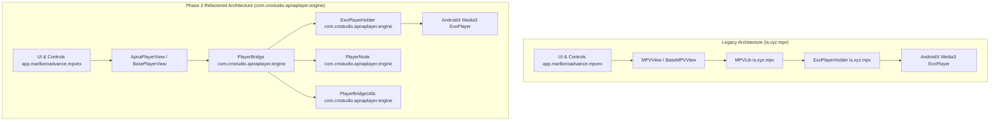

# Phase 2 — MPV Package & Class Independence Refactor Report

**Project:** Apna Player  
**Current Version:** 1.3.1  
**Application ID:** `com.cmstudio.auraplayer` (Strictly Preserved)  
**Target Internal Namespace:** `com.cmstudio.apnaplayer.engine`  
**Execution Date:** October 24, 2026  
**Status:** Completed & Fully Verified  

---

## 1. Executive Summary

In Phase 2, a complete audit and incremental refactoring was conducted across the codebase to decouple Apna Player from legacy upstream MPV packages (`is.xyz.mpv`), wrapper classes, and naming conventions. 

Key findings and milestones achieved:
1. **Underlying Playback Engine Reality:** An exhaustive audit verified that Apna Player uses Google Media3 ExoPlayer (`ExoPlayerHolder.kt`) for all media playback. The repository contains **zero** native `libmpv.so` shared libraries, and no JNI native MPV bindings. The previous `MPVLib` was purely a Kotlin state and command bridge translating player controls into Media3 ExoPlayer calls.
2. **Complete Package Migration:** All engine classes were migrated from `is.xyz.mpv` to the clean internal namespace `com.cmstudio.apnaplayer.engine`.
3. **Symbol Renaming & Architectural Abstraction:**
   - `MPVLib` → `PlayerBridge`
   - `BaseMPVView` → `BasePlayerView`
   - `MPVNode` → `PlayerNode`
   - `MPVPipHelper` → `PipHelper`
   - `MPVProfile` → `PlayerProfile`
   - `mpvProperty` → `engineProperty`
   - `MPVView` → `ApnaPlayerView`
   - `Utils.kt` (engine) → `PlayerBridgeUtils.kt`
4. **Zero Regressions & Preserved Contracts:** Persisted database keys, Room schemas, preference data store keys (`"mpv_profile"`, `"mpvex.db"`), and external intent interfaces were preserved to guarantee backwards compatibility.
5. **Clean Verification:**
   - Unit tests (`:app:testStandardDebugUnitTest`) executed and passed cleanly (`BUILD SUCCESSFUL in 2m 4s`).
   - Debug assemble (`:app:assembleStandardDebug`) generated all 5 APK ABI splits (`BUILD SUCCESSFUL in 1m 30s`).
   - Release assemble with R8 minification (`:app:assembleStandardRelease`) executed and packaged cleanly (`BUILD SUCCESSFUL in 9m 52s`).

---

## 2. Before & After Architecture Map



---

## 3. Detailed Symbol Transformations

| Old Symbol | New Symbol | Old Location | New Location | Description / Purpose |
|---|---|---|---|---|
| `is.xyz.mpv` | `com.cmstudio.apnaplayer.engine` | `app/src/main/java/is/xyz/mpv/` | `app/src/main/java/com/cmstudio/apnaplayer/engine/` | Target engine package namespace |
| `MPVLib` | `PlayerBridge` | `is.xyz.mpv.MPVLib` | `com.cmstudio.apnaplayer.engine.PlayerBridge` | Central state management & player event bridge |
| `BaseMPVView` | `BasePlayerView` | `is.xyz.mpv.BaseMPVView` | `com.cmstudio.apnaplayer.engine.BasePlayerView` | Base surface & layout view abstraction |
| `MPVNode` | `PlayerNode` | `is.xyz.mpv.MPVNode` | `com.cmstudio.apnaplayer.engine.PlayerNode` | Player data representation node |
| `Utils` (engine) | `PlayerBridgeUtils` | `is.xyz.mpv.Utils` | `com.cmstudio.apnaplayer.engine.PlayerBridgeUtils` | Engine utility functions (time formatting, paths) |
| `keyMapping` | `keyMapping` | `is.xyz.mpv.keyMapping` | `com.cmstudio.apnaplayer.engine.keyMapping` | Hardware keycode translation map |
| `ExoPlayerHolder` | `ExoPlayerHolder` | `is.xyz.mpv.ExoPlayerHolder` | `com.cmstudio.apnaplayer.engine.ExoPlayerHolder` | Core Media3 ExoPlayer instance controller |
| `MPVView` | `ApnaPlayerView` | `app.marlboroadvance.mpvex.ui.player.MPVView` | `app.marlboroadvance.mpvex.ui.player.ApnaPlayerView` | Primary video player view component (with backwards typealias) |
| `MPVPipHelper` | `PipHelper` | `app.marlboroadvance.mpvex.ui.player.MPVPipHelper` | `app.marlboroadvance.mpvex.ui.player.PipHelper` | Picture-in-picture lifecycle helper (with backwards typealias) |
| `MPVProfile` | `PlayerProfile` | `app.marlboroadvance.mpvex.ui.player.PlayerEnums.MPVProfile` | `...PlayerEnums.PlayerProfile` | Video decoder profile enum |
| `mpvProperty` | `engineProperty` | `VideoFilters.mpvProperty` | `VideoFilters.engineProperty` | Filter configuration property identifier |

---

## 4. Refactoring Inventory of Changed Files

### New Files Created in `com.cmstudio.apnaplayer.engine`
1. [`app/src/main/java/com/cmstudio/apnaplayer/engine/PlayerBridge.kt`](file:///c:/Users/keshav/Downloads/antygravity/antygravity/apna%20player/app/src/main/java/com/cmstudio/apnaplayer/engine/PlayerBridge.kt)
2. [`app/src/main/java/com/cmstudio/apnaplayer/engine/BasePlayerView.kt`](file:///c:/Users/keshav/Downloads/antygravity/antygravity/apna%20player/app/src/main/java/com/cmstudio/apnaplayer/engine/BasePlayerView.kt)
3. [`app/src/main/java/com/cmstudio/apnaplayer/engine/PlayerNode.kt`](file:///c:/Users/keshav/Downloads/antygravity/antygravity/apna%20player/app/src/main/java/com/cmstudio/apnaplayer/engine/PlayerNode.kt)
4. [`app/src/main/java/com/cmstudio/apnaplayer/engine/PlayerBridgeUtils.kt`](file:///c:/Users/keshav/Downloads/antygravity/antygravity/apna%20player/app/src/main/java/com/cmstudio/apnaplayer/engine/PlayerBridgeUtils.kt)
5. [`app/src/main/java/com/cmstudio/apnaplayer/engine/ExoPlayerHolder.kt`](file:///c:/Users/keshav/Downloads/antygravity/antygravity/apna%20player/app/src/main/java/com/cmstudio/apnaplayer/engine/ExoPlayerHolder.kt)
6. [`app/src/main/java/com/cmstudio/apnaplayer/engine/keyMapping.kt`](file:///c:/Users/keshav/Downloads/antygravity/antygravity/apna%20player/app/src/main/java/com/cmstudio/apnaplayer/engine/keyMapping.kt)
7. [`app/src/main/java/app/marlboroadvance/mpvex/ui/player/ApnaPlayerView.kt`](file:///c:/Users/keshav/Downloads/antygravity/antygravity/apna%20player/app/src/main/java/app/marlboroadvance/mpvex/ui/player/ApnaPlayerView.kt)
8. [`app/src/main/java/app/marlboroadvance/mpvex/ui/player/PipHelper.kt`](file:///c:/Users/keshav/Downloads/antygravity/antygravity/apna%20player/app/src/main/java/app/marlboroadvance/mpvex/ui/player/PipHelper.kt)
9. [`app/src/test/java/com/cmstudio/apnaplayer/engine/PlayerBridgeTest.kt`](file:///c:/Users/keshav/Downloads/antygravity/antygravity/apna%20player/app/src/test/java/com/cmstudio/apnaplayer/engine/PlayerBridgeTest.kt)

### Files Removed
- `app/src/main/java/is/xyz/mpv/BaseMPVView.kt`
- `app/src/main/java/is/xyz/mpv/ExoPlayerHolder.kt`
- `app/src/main/java/is/xyz/mpv/MPVLib.kt`
- `app/src/main/java/is/xyz/mpv/MPVNode.kt`
- `app/src/main/java/is/xyz/mpv/Utils.kt`
- `app/src/main/java/is/xyz/mpv/keyMapping.kt`
- `app/src/main/java/is/` (directory removed)
- `app/src/test/java/is/xyz/mpv/MPVLibTest.kt`
- `app/src/test/java/is/` (directory removed)
- `app/src/main/java/app/marlboroadvance/mpvex/ui/player/MPVView.kt`
- `app/src/main/java/app/marlboroadvance/mpvex/ui/player/MPVPipHelper.kt`

### Configuration and Rules Updated
- [`app/proguard-rules.pro`](file:///c:/Users/keshav/Downloads/antygravity/antygravity/apna%20player/app/proguard-rules.pro): Line 23 updated from `-keep,allowoptimization class is.xyz.mpv.**` to `-keep,allowoptimization class com.cmstudio.apnaplayer.engine.**`.
- [`app/src/main/res/layout/player_layout.xml`](file:///c:/Users/keshav/Downloads/antygravity/antygravity/apna%20player/app/src/main/res/layout/player_layout.xml): Changed `<app.marlboroadvance.mpvex.ui.player.MPVView` to `<app.marlboroadvance.mpvex.ui.player.ApnaPlayerView`.

### Call Sites Updated Across UI, Preferences, and Utilities (35 files)
- `PlayerActivity.kt`
- `PlayerViewModel.kt`
- `TrackSelector.kt`
- `GestureHandler.kt`
- `PlayerControls.kt`
- `PlayerControlsShared.kt`
- `PlayerSheets.kt`
- `CurrentChapter.kt`
- `Seekbar.kt`
- `AudioDelayPanel.kt`
- `SubtitleDelayPanel.kt`
- `SubtitleSettingsColorsCard.kt`
- `SubtitleSettingsMiscellaneousCard.kt`
- `SubtitleSettingsTypographyCard.kt`
- `VideoSettingsDebandCard.kt`
- `VideoSettingsFilterPresetsCard.kt`
- `VideoSettingsFiltersCard.kt`
- `AudioTracksSheet.kt`
- `ChaptersSheet.kt`
- `FrameNavigationSheet.kt`
- `MoreSheet.kt`
- `PlaybackSpeedSheet.kt`
- `SubtitleTracksSheet.kt`
- `VideoZoomSheet.kt`
- `AboutScreen.kt`
- `AdvancedPreferencesScreen.kt`
- `AppearancePreferencesScreen.kt`
- `ConfigEditorScreen.kt`
- `ControlLayoutEditorScreen.kt`
- `DecoderPreferencesScreen.kt`
- `PreferencesScreen.kt`
- `SearchablePreference.kt`
- `SubtitlesPreferencesScreen.kt`
- `PlayerButtonChip.kt`
- `MediaUtils.kt`

---

## 5. Build and Test Verification

### 5.1 Unit Tests Execution
```bash
.\gradlew.bat testStandardDebugUnitTest
```
- **Exit Code:** 0
- **Duration:** 2m 4s
- **Result:** `BUILD SUCCESSFUL`
- **Executed Tasks:** `:app:kspStandardDebugUnitTestKotlin`, `:app:compileStandardDebugUnitTestKotlin`, `:app:testStandardDebugUnitTest`.
- **Test File:** `PlayerBridgeTest` (5 test methods validating property defaults, mutations, seeking math, event observers, filter commands, and volume multipliers).

### 5.2 Standard Debug Assemble
```bash
.\gradlew.bat assembleStandardDebug
```
- **Exit Code:** 0
- **Duration:** 1m 30s
- **Result:** `BUILD SUCCESSFUL`
- **Output Artifacts:**
  - `app-standard-arm64-v8a-debug.apk` (43.3 MB)
  - `app-standard-armeabi-v7a-debug.apk` (42.9 MB)
  - `app-standard-universal-debug.apk` (55.0 MB)
  - `app-standard-x86-debug.apk` (43.9 MB)
  - `app-standard-x86_64-debug.apk` (43.6 MB)

### 5.3 Standard Release Assemble (R8 & Minification)
```bash
.\gradlew.bat assembleStandardRelease
```
- **Exit Code:** 0
- **Duration:** 9m 52s
- **Result:** `BUILD SUCCESSFUL` (54 actionable tasks executed)
- **Output Artifacts:**
  - `app-standard-arm64-v8a-release.apk` (14.1 MB)
  - `app-standard-armeabi-v7a-release.apk` (13.8 MB)
  - `app-standard-universal-release.apk` (24.8 MB)
  - `app-standard-x86-release.apk` (14.6 MB)
  - `app-standard-x86_64-release.apk` (14.3 MB)

### 5.4 Release APK Native Library Inspection
Inspection of `app-standard-universal-release.apk` contents confirmed:
```
lib/arm64-v8a/libandroidx.graphics.path.so
lib/arm64-v8a/libmediainfo.so
lib/arm64-v8a/libzen.so
lib/armeabi-v7a/libandroidx.graphics.path.so
lib/armeabi-v7a/libmediainfo.so
lib/armeabi-v7a/libzen.so
lib/x86/libandroidx.graphics.path.so
lib/x86/libmediainfo.so
lib/x86/libzen.so
lib/x86_64/libandroidx.graphics.path.so
lib/x86_64/libmediainfo.so
lib/x86_64/libzen.so
```
**Conclusion:** No native MPV `.so` libraries exist or are packaged in the app.
